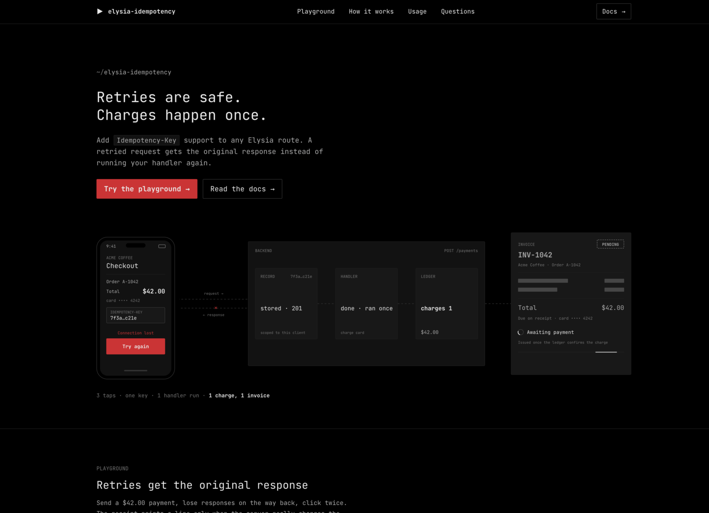

# elysia-idempotency

[](https://idempotency.yosefalhamad.com)

`Idempotency-Key` support for [Elysia](https://elysiajs.com) on Bun: when a client retries a `POST`, the handler runs once and every retry gets the original response.

**Live demo:** fire retries, double clicks, and races at a real endpoint and watch what the plugin does at [idempotency.yosefalhamad.com](https://idempotency.yosefalhamad.com).

## Install

```sh
bun add elysia-idempotency
```

`elysia` (^1.4.30) and `zod` (^4.6.7) are peer dependencies. Requires Bun 1.3 or newer.

## Quick start

```ts
import { Elysia } from 'elysia'
import { idempotency } from 'elysia-idempotency'

let charges = 0

const app = new Elysia()
  .use(idempotency())
  .post('/charges', ({ body }) => ({ charge: ++charges, body }))
  .listen(3000)
```

Send the same request twice with the same key:

```sh
curl -i -X POST localhost:3000/charges -H 'Idempotency-Key: 3f1c9a52-8d0e-4a63-9c5b-2a7d1e6f4b80' -H 'Content-Type: application/json' -d '{"amount":500}'
curl -i -X POST localhost:3000/charges -H 'Idempotency-Key: 3f1c9a52-8d0e-4a63-9c5b-2a7d1e6f4b80' -H 'Content-Type: application/json' -d '{"amount":500}'
```

Both answers are `{"charge":1,...}`. The handler ran once, and the second response carries `Idempotent-Replayed: true`.

The default store is a `MemoryStore`, which lives inside one process. **If your app runs on more than one instance, use Redis**, or a retry that lands on another instance runs the handler again. See [Redis with Bun](#redis-with-bun).

## What happens on a retry

The plugin acts on `POST` and `PATCH` requests that carry an `Idempotency-Key` header. Requests without the header pass through untouched, unless you set `required: true`.

For each key, scoped to the client that sent it:

1. **First request.** The plugin writes an in-progress lock and runs your handler.
2. **Same key while the first one is still running.** The handler does not run. The client gets `409` with `Retry-After: 1`.
3. **First request finishes with a storable status** (most 2xx, 3xx, and 4xx, see [`shouldStore`](#which-responses-are-stored)). The response is saved for `retention` (default 24 hours).
4. **Same key, same request, after that.** The handler does not run. The client gets the saved status, headers, and body, plus `Idempotent-Replayed: true`.
5. **Same key, different request** (other body, path, query, or method). The client gets `422`. The saved response is never handed to a different request.
6. **The handler throws, or returns a 5xx** (or another status that is not stored). The lock is removed and the client gets the original response. A retry runs the handler again.
7. **The process crashes mid-request.** The lock expires after `lockTimeout` (default 1 minute), and a retry runs the handler again.
8. **`retention` passes.** The record is gone, and the same key counts as a new request.

## Status codes and what clients should do

| Status | Body `error` | Meaning | What the client should do |
| --- | --- | --- | --- |
| Original status, with `Idempotent-Replayed: true` | your handler's body | A replay of the first response | Treat it exactly like the first response |
| `400` | `Idempotency-Key header is required` | `required: true` and no key was sent | Send a key |
| `400` | `Idempotency-Key header is invalid` | Key is longer than 255 characters, has spaces, quotes, backslashes, or control characters, or the header has several values | Fix the client; do not retry as is |
| `409` | `A request with this Idempotency-Key is still in progress` | The first request with this key has not finished yet | Wait for `Retry-After` seconds and retry with the **same** key |
| `422` | `Idempotency-Key was already used with a different request` | The key was reused for a request with a different body, path, or method | A client bug: use a new key for a new operation |
| `503` | `Idempotency is temporarily unavailable` | The store failed and `failureMode` is `'closed'` | Wait for `Retry-After` seconds and retry with the **same** key |

Keys may be sent bare (`Idempotency-Key: abc`) or as a quoted string (`Idempotency-Key: "abc"`), as in the IETF `draft-ietf-httpapi-idempotency-key-header`. UUIDs, ULIDs, and base64url strings all fit.

Elysia's own schema validation also answers `422`. Those requests never reach the plugin and create no record, so the client can fix the body and retry with the same key.

## Options

| Option | Type | Default | Meaning |
| --- | --- | --- | --- |
| `store` | `IdempotencyStore` | a new `MemoryStore` | Where records live. A store you pass in is never closed by the plugin |
| `prefix` | `string` | `'idempotency'` | Store key prefix, 1 to 64 letters, digits, `_` or `-`. Use different prefixes for different plugins on one store |
| `retention` | `number \| string` | `'24h'` | How long a completed response is replayed. Milliseconds, or `"30s"`, `"15m"`, `"24h"`, `"7d"`. 1 second to 30 days |
| `lockTimeout` | `number \| string` | `'1m'` | How long an in-progress lock lives if the request never finishes. 1 second to 1 hour, at most `retention`. Set it longer than your slowest handler |
| `header` | `string` | `'Idempotency-Key'` | Request header to read the key from |
| `methods` | `string[]` | `['POST', 'PATCH']` | Methods the plugin acts on; other methods pass through. May not include `GET`, `HEAD`, or `OPTIONS` |
| `required` | `boolean` | `false` | Answer `400` when a covered request has no key |
| `fingerprint` | `boolean \| (ctx) => string \| Promise<string>` | `true` | `true`: hash of method, path with query, and raw body. `false`: never compare requests, so a reused key always replays. A function: your own fingerprint string, hashed before it is stored |
| `identity` | `(ctx) => string \| Promise<string>` | see [Identity](#identity) | Who owns a key. Records never cross identities |
| `trustProxy` | `boolean \| number` | `false` | Used by the default identity only. Whether to read `X-Forwarded-For`; a number is how many proxies (1 to 32) sit in front of the app |
| `ipv6Subnet` | `number` | `56` | Used by the default identity only. IPv6 clients in the same `/ipv6Subnet` share a scope (0 to 128) |
| `maxBodyBytes` | `number` | `1048576` (1 MiB) | Largest response body stored for replay, 0 to 16 MiB. Larger bodies are not stored, see [Limits](#limits-and-trade-offs) |
| `shouldStore` | `(status: number) => boolean` | see [below](#which-responses-are-stored) | Which response statuses are stored. Any other status releases the key so a retry runs again |
| `excludeHeaders` | `string[]` | `[]` | Extra response headers that are never stored or replayed (case-insensitive) |
| `failureMode` | `'open' \| 'closed'` | `'closed'` | When the store fails: answer `503` (`closed`), or run the handler without protection (`open`) |
| `onRejected` | `(ctx, rejection) => unknown` | JSON bodies above | Custom body or `Response` for `400`, `409`, `422`, and `503`. May be async. Returning `undefined` or `null`, or throwing, uses the default body, so the request is still rejected |
| `scope` | `'global' \| 'scoped' \| 'local'` | `'scoped'` | Elysia hook scope, see [Scope](#scope) |
| `clock` | `Clock` | system clock | An object with `now(): number` in ms. Useful for tests |

Unknown options and invalid values throw an `IdempotencyConfigError` when `idempotency()` is called, with a message naming each bad field:

```text
Invalid idempotency options:
methods: Methods must not include GET, HEAD or OPTIONS
```

### Why `failureMode` defaults to `'closed'`

When the store is down, the plugin cannot tell a first request from a retry. Running the handler anyway (`'open'`) is exactly the moment a payment can be charged twice: the client times out, retries, and both requests go through. So by default the plugin answers `503` with `Retry-After: 1`, and the client retries later with the same key. Choose `'open'` only for routes where running twice is harmless and staying up matters more. In open mode the handler sees `ctx.idempotency.status === 'unavailable'`.

### Which responses are stored

A status outside 200 to 599 is never stored. The default `shouldStore` stores every status below `500` except `401`, `403`, `408`, `409`, `425`, and `429`. Those are temporary or auth failures, so they stay retryable, and unauthenticated requests do not take store space. Every 5xx releases the key, so a client can retry after a server error.

**Why a thrown error releases the key:** a throw means your handler did not finish its work, and Elysia turns it into a `500`. Storing that would replay a failure forever, even after you fix the bug or the database comes back. Releasing the key lets the client's retry run the handler again. So:

- **Return** an error with `status(402, { error: 'card_declined' })` when the outcome is final and should be replayed.
- **Throw** when the operation should stay retryable.

### Identity

Every key belongs to a scope, so one client can never receive another client's stored response, even if both send the same key. The default identity is, in order:

1. `auth:` plus the `Authorization` header, if present (hashed before it reaches the store),
2. `ip:` plus the client address (IPv4, or the IPv6 `/ipv6Subnet`), using `trustProxy`,
3. `anonymous`.

Apps that use cookie sessions should set `identity` to the user id, because two users behind one NAT would otherwise share a scope. See [Cookie sessions](#cookie-session-identity).

### The `ctx` argument

`identity`, `fingerprint`, and `onRejected` receive:

```ts
import type { Context } from 'elysia'

interface IdempotencyRequestContext {
  readonly request: Request
  readonly path: string
  readonly ip: string | null
  readonly elysia: Context
}
```

`ip` is the client address after proxy handling, or `null` when none is known (for example in `app.handle()` tests). `onRejected` also gets the rejection:

```ts
type IdempotencyRejection =
  | { readonly reason: 'missing-key'; readonly status: 400 }
  | { readonly reason: 'invalid-key'; readonly status: 400 }
  | { readonly reason: 'in-progress'; readonly status: 409 }
  | { readonly reason: 'mismatch'; readonly status: 422 }
  | { readonly reason: 'unavailable'; readonly status: 503 }
```

### The `idempotency` context value

Handlers get the outcome as `ctx.idempotency`, fully typed:

```ts
import type { IdempotencyError, IdempotencyRejection } from 'elysia-idempotency'

type IdempotencyOutcome =
  | { readonly status: 'skipped' }
  | { readonly status: 'started'; readonly key: string }
  | { readonly status: 'replayed' }
  | { readonly status: 'rejected'; readonly rejection: IdempotencyRejection }
  | { readonly status: 'unavailable'; readonly error: IdempotencyError }
```

A handler only ever runs with `'skipped'` (no key, or an uncovered method), `'started'`, or `'unavailable'` in open mode. Replays and rejections are answered before the handler.

### Scope

- `'scoped'` (default): covers the routes of the instance that calls `.use(idempotency(...))` that are registered after that call.
- `'global'`: covers every route of every app the plugin ends up in.
- `'local'`: covers only routes registered on the returned plugin itself, as in `idempotency({ scope: 'local' }).post('/x', ...)`.

Elysia hooks only apply to routes registered after them, so always `.use(idempotency(...))` before the routes it should protect.

## Recipes

### Payments with Stripe-style keys

Require a key on the route that charges money, store the outcome for a day, and return declines with `status()` so they are replayed instead of retried:

```ts
import { Elysia, t } from 'elysia'
import { idempotency } from 'elysia-idempotency'

const chargeCard = async (amount: number): Promise<{ id: string; declined: boolean }> => ({
  id: crypto.randomUUID(),
  declined: amount > 100_000,
})

const app = new Elysia()
  .use(idempotency({ required: true, retention: '24h', lockTimeout: '2m' }))
  .post(
    '/payments',
    async ({ body, status }) => {
      const charge = await chargeCard(body.amount)
      if (charge.declined) return status(402, { error: 'card_declined' })
      return status(201, { id: charge.id, amount: body.amount })
    },
    { body: t.Object({ amount: t.Integer({ minimum: 1 }) }) },
  )
```

A client that times out and retries gets the same `201` (or the same `402`), and the card is charged once.

### Require keys on one route group

Put the plugin at the top of the sub-instance that owns the routes. Other routes of the app are not covered:

```ts
import { Elysia } from 'elysia'
import { idempotency } from 'elysia-idempotency'

const orders = new Elysia({ prefix: '/orders' })
  .use(idempotency({ required: true, prefix: 'orders' }))
  .post('/', () => ({ created: true }))
  .patch('/:id', ({ params }) => ({ updated: params.id }))

const app = new Elysia()
  .post('/search', () => ({ results: [] }))
  .use(orders)
```

### Cookie session identity

```ts
import { Elysia } from 'elysia'
import { idempotency } from 'elysia-idempotency'

const sessions = new Map<string, { readonly userId: string }>()

const app = new Elysia()
  .use(
    idempotency({
      identity: ({ elysia, ip }) => {
        const sessionId = elysia.cookie.session?.value
        const session = typeof sessionId === 'string' ? sessions.get(sessionId) : undefined
        if (session !== undefined) return `user:${session.userId}`
        return ip === null ? 'anonymous' : `ip:${ip}`
      },
    }),
  )
  .post('/posts', () => ({ created: true }))
```

Replace `sessions` with your own session lookup. Return a stable, unique id per user; anything returned is hashed before it reaches the store.

### Redis with Bun

Bun's built-in `RedisClient` works as is:

```ts
import { RedisClient } from 'bun'
import { Elysia } from 'elysia'
import { RedisStore, idempotency } from 'elysia-idempotency'

const redis = new RedisClient(process.env.REDIS_URL ?? 'redis://localhost:6379')
const store = new RedisStore({ client: redis })

const app = new Elysia()
  .use(idempotency({ store }))
  .post('/orders', () => ({ created: true }))
  .onStop(() => redis.close())
```

Every update is an optimistic compare-and-set Lua script, so several app instances can share one Redis and two identical requests on different instances still never both run the handler. If another instance keeps changing a key, the store retries up to `maxAttempts` times (default `5`, 1 to 20) and then fails with `StoreConflictError`, which `failureMode` handles like any store failure.

### ioredis and node-redis

`RedisStore` only needs an object with `send(command, args)`. One-line adapters:

```ts
import Redis from 'ioredis'
import { RedisStore } from 'elysia-idempotency'

const redis = new Redis(process.env.REDIS_URL ?? 'redis://localhost:6379')
const store = new RedisStore({ client: { send: (command, args) => redis.call(command, ...args) } })
```

```ts
import { createClient } from 'redis'
import { RedisStore } from 'elysia-idempotency'

const redis = await createClient({ url: process.env.REDIS_URL ?? 'redis://localhost:6379' }).connect()
const store = new RedisStore({ client: { send: (command, args) => redis.sendCommand([command, ...args]) } })
```

### With elysia-rate-limiter

`.use()` the rate limiter **first**, then this plugin:

```ts
import { Elysia } from 'elysia'
import { idempotency } from 'elysia-idempotency'
import { rateLimit } from 'elysia-rate-limiter'

const app = new Elysia()
  .use(rateLimit({ limit: 20, window: '1m' }))
  .use(idempotency())
  .post('/orders', () => ({ created: true }))
```

In this order every retry, including a replay, counts against the limit, so a client cannot use replays to get around it. A blocked `429` is never stored, so the client can retry with the same key once the window resets. Stored responses never keep `RateLimit-*` or `Retry-After` headers, and a replay carries fresh ones from the rate limiter.

### Generating keys on the client

Make one key per user action, keep it while you retry that action, and make a new key for the next action:

```ts
const wait = (ms: number) => new Promise((resolve) => setTimeout(resolve, ms))

export const createOrder = async (order: { readonly item: string; readonly quantity: number }): Promise<Response> => {
  const key = crypto.randomUUID()
  const body = JSON.stringify(order)
  for (let attempt = 1; attempt <= 5; attempt += 1) {
    const response = await fetch('https://api.example.com/orders', {
      method: 'POST',
      headers: { 'Content-Type': 'application/json', 'Idempotency-Key': key },
      body,
    }).catch(() => null)
    if (response !== null && response.status !== 409 && response.status < 500) return response
    await wait(attempt * 1_000)
  }
  throw new Error('The order could not be sent. Try again later.')
}
```

Send exactly the same body on every retry. The default fingerprint compares raw bytes, so even a different JSON key order counts as a different request and gets `422`.

### The engine in a queue consumer

`IdempotencyEngine` works without Elysia: queue consumers, webhook handlers, cron jobs. Use the message id as the key, and `complete` or `release` when done:

```ts
import { IdempotencyEngine } from 'elysia-idempotency'

interface OrderPaid {
  readonly messageId: string
  readonly orderId: string
}

const engine = new IdempotencyEngine({ retention: '7d', lockTimeout: '5m' })

const shipOrder = async (orderId: string): Promise<void> => {
  console.log(`shipping ${orderId}`)
}

export const onOrderPaid = async (message: OrderPaid): Promise<'done' | 'duplicate' | 'busy'> => {
  const fingerprint = Bun.CryptoHasher.hash('sha256', JSON.stringify(message), 'hex')
  const outcome = await engine.begin({ scope: 'order-paid', key: message.messageId, fingerprint })
  if (outcome.kind === 'replay' || outcome.kind === 'mismatch') return 'duplicate'
  if (outcome.kind === 'in-progress') return 'busy'
  try {
    await shipOrder(message.orderId)
    await engine.complete(outcome.lease, { status: 200, headers: [], body: null, bodyOmitted: false })
    return 'done'
  } catch (error) {
    await engine.release(outcome.lease)
    throw error
  }
}
```

Requeue `'busy'` messages with a delay; another consumer is still working on that message.

| Member | Meaning |
| --- | --- |
| `new IdempotencyEngine(options?)` | Options: `store`, `prefix`, `retention`, `lockTimeout`, `clock`, as in the table above |
| `begin({ scope, key, fingerprint })` | `fingerprint` is 64 lowercase hex characters or `null`. Returns `{ kind: 'started', lease }`, `{ kind: 'replay', response }`, `{ kind: 'in-progress' }`, or `{ kind: 'mismatch' }` |
| `complete(lease, response)` | Stores the result for `retention`. Returns `false` if another holder took the key after the lock expired |
| `release(lease)` | Removes the lock so the next attempt runs again. Returns whether it removed it |
| `close()` | Closes the store if the engine created it. Stores you pass in stay open |

### Custom stores and memory limits

`MemoryStore` options: `maxKeys` (default `10_000`), `maxBytes` (default 64 MiB, counted as key plus value length), `sweepIntervalMs` (default `60_000`; how often expired records are removed), and `clock`.

To write your own store, implement `IdempotencyStore`. Stores only move strings. `update` must be atomic per key: no other update to that key may happen between the read and the write.

```ts
import type { StoreMutation } from 'elysia-idempotency'

interface IdempotencyStore {
  read(key: string): Promise<string | null>
  update<TResult>(key: string, mutation: StoreMutation<TResult>): Promise<TResult>
  delete(key: string): Promise<void>
  close?(): Promise<void>
}
```

A mutation returns `{ action: 'set', value, ttlMs, result }`, `{ action: 'delete', result }`, or `{ action: 'keep', result }`.

## Limits and trade-offs

- **Not a replacement for database constraints.** The plugin stops the same request from running twice. It does not stop two *different* requests (two keys, or no key at all) from creating the same order, and it cannot help if a record expires or the store is wiped. Keep unique constraints and transactions in your database; treat this plugin as the layer that makes client retries safe.
- **Corrupt records.** A stored record that is not valid JSON or has the wrong shape is treated as no record: the next request runs the handler and overwrites it. It never crashes or replays garbage, but a tampered store can make one request run again.
- **A full memory store answers `503`.** `MemoryStore` never evicts a live record, because evicting would let one client push other clients' locks and saved responses out and make their retries run twice. When it reaches `maxKeys` or `maxBytes`, new keys get `503` (in closed mode) until records expire. Anyone who can get responses stored can fill it, so use Redis in production and whenever you run more than one instance.
- **`parse: 'none'` routes hold the body while it is hashed.** The fingerprint reads a copy of the body as a stream with constant memory. On normal routes Elysia's parser reads alongside it. A `parse: 'none'` route reads its body only in the handler, after hashing finishes, so the whole body is held until then (bounded by Bun's `maxRequestBodySize`). For streaming uploads, use `fingerprint: false` or a fingerprint function that does not read the body.
- **Large responses are replayed without a body.** A response body over `maxBodyBytes`, a `text/event-stream` response, or one with an oversized `Content-Length` is not read into memory. The handler still never runs twice, but the replay has the original status and headers with an empty body.
- **A handler slower than `lockTimeout`.** The lock expires while the handler is still running, so a retry can run the handler a second time. Only one of the two responses is stored. Set `lockTimeout` comfortably above your slowest handler.
- **Per process memory.** `MemoryStore` protects one process. Use Redis for more than one instance.

## Errors

All errors extend `IdempotencyError`.

| Error | When |
| --- | --- |
| `IdempotencyConfigError` | Invalid options, thrown at startup by `idempotency()`, `new IdempotencyEngine()`, `new MemoryStore()`, or `new RedisStore()`. The message names every bad field |
| `StoreUnavailableError` | The store failed, returned something unexpected, or (memory store) is full. The original error is the `cause` |
| `StoreConflictError` | Redis kept changing under the update for `maxAttempts` tries |

In the plugin, store errors never become a `500`: closed mode answers `503`, open mode runs the handler with `ctx.idempotency.status === 'unavailable'`. An `identity` or `fingerprint` function that throws or returns a non-string is a bug in your code and fails the request.

## Security notes

- **Identity scoping.** Records are keyed by identity plus key, so a client that guesses or copies another client's key gets a fresh request, never the other client's response.
- **Proxy headers.** `X-Forwarded-For` is ignored by the default identity unless you set `trustProxy`. Prefer a hop count over `true`.
- **Hashed keys.** Store keys are `prefix:sha256([identity, key])`. Raw keys, IPs, and `Authorization` values never reach the store, and an identity or key containing `:` or `"` cannot collide with another pair.
- **Headers never stored.** `Set-Cookie`, `Authorization`, `Proxy-Authenticate`, hop-by-hop headers, `Content-Length`, `Date`, `Retry-After`, and `RateLimit-*` are never stored or replayed. Add your own with `excludeHeaders`.
- **Strict keys.** Keys must be 1 to 255 printable ASCII characters with no spaces, quotes, or backslashes. Anything else gets `400` before it reaches the store, and its body is never hashed.
- **Fingerprints.** A reused key with a different body, path, query, or method gets `422` instead of someone else's result.
- **Bounded memory.** Request bodies are hashed as a stream. Response bodies are read only up to `maxBodyBytes`. `MemoryStore` holds at most `maxKeys` entries and `maxBytes` of data.
- **Validated records.** Everything read back from a store is checked with a Zod schema before use.
- **Redis.** User data only travels as Lua script arguments, never as script text.
- **Error bodies.** `400`, `409`, `422`, and `503` bodies contain no stack traces, keys, store keys, or store details.

## For AI agents

Paste this prompt into your coding agent to add idempotency to an Elysia app:

````text
Add Idempotency-Key support to this Elysia app (Bun) using the elysia-idempotency package, so a retried request returns the original response instead of running the handler again.

1. Install it with `bun add elysia-idempotency`. Use Bun for every command (`bun add`, `bun test`, `bunx`).
2. Import with `import { idempotency } from 'elysia-idempotency'`.
3. Decide which routes to protect. Protect POST and PATCH routes that create or change something and would do harm if they ran twice: payments, charges, refunds, orders, transfers, sending email or SMS, creating accounts or resources, calls to external APIs that cost money. Do not protect GET routes, search, login, or routes that are already safe to repeat.
4. Where to put `.use()`: hooks apply to the instance that calls `.use(idempotency(...))`, and only to routes registered after that call. Put the plugin at the top of the router (sub-instance) that owns the protected routes, then `.use()` that router in the main app. Use `required: true` on routes where a missing key should be an error (payments), and the default `required: false` where old clients must keep working.
5. Return final errors with `status(4xx, body)` so they are stored and replayed (for example `status(402, { error: 'card_declined' })`). Throw for errors that should stay retryable; a thrown error or a 5xx releases the key.
6. Identity: by default records are scoped by the Authorization header, then client IP. If the app uses cookie sessions, set `identity: ({ elysia, ip }) => <this app's user id lookup> ?? (ip === null ? 'anonymous' : 'ip:' + ip)`. If the app is behind a reverse proxy, set `trustProxy` to the number of proxies in front of it (for example `trustProxy: 1`).
7. Set `lockTimeout` longer than the slowest protected handler (default '1m'), and `retention` to how long clients may retry (default '24h').
8. If the app runs on more than one instance (several containers, pods, or workers), or in production, switch to Redis, because the default memory store only works inside one process:
   import { RedisClient } from 'bun'
   import { RedisStore, idempotency } from 'elysia-idempotency'
   const store = new RedisStore({ client: new RedisClient(process.env.REDIS_URL) })
   then pass `store` to every `idempotency({ ... })`, with a different `prefix` for each plugin that shares it.
9. If the app also uses elysia-rate-limiter, `.use(rateLimit(...))` before `.use(idempotency(...))`.
10. Update every client that calls a protected route: generate one key per user action with `crypto.randomUUID()`, send it as the `Idempotency-Key` header, reuse the same key and the exact same body when retrying that action (after network errors, 409, 5xx, or 503), and generate a new key for the next action. Never reuse a key for a different request; that gets 422.
11. Keep the database's unique constraints and transactions; this plugin makes retries safe but does not replace them.
12. Add a test with `app.handle(new Request('http://localhost/route', { method: 'POST', headers: { 'Idempotency-Key': 'test-key-1', 'Content-Type': 'application/json' }, body }))`: send it twice, expect the handler to run once, both bodies to match, and the second response to have the header `Idempotent-Replayed: true`. Then send the same key with a different body and expect 422.
13. Run the type checker and tests.
````

## License

MIT
